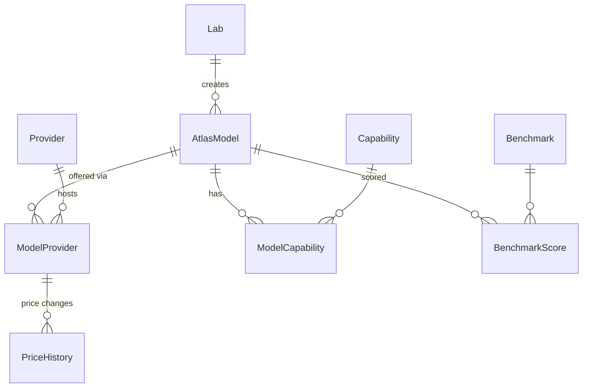

# OneAtlas API: AI model discovery & intelligence platform (Backend)

NestJS + TypeScript + Prisma + PostgreSQL. Browse, search, filter, sort, compare and rank AI models across labs and
inference providers, with per-provider pricing, benchmarks and price history.

> Role: **Backend Engineer**. Swagger UI at `/docs` is the interactive frontend for this API.

## Quick start

```bash
cp .env.example .env
docker compose up -d                 # local Postgres (or point DATABASE_URL at Neon)
npm install
npx prisma migrate dev --name init   # creates tables + pg_trgm extension + trigram indexes
npm run seed                         # 40 models, 15 labs, 16 providers, 6 benchmarks, 200+ scores/prices
npm run start:dev                    # http://localhost:3000/docs
npm run ingest:openrouter            # optional: ingest live catalogue from OpenRouter
npm run test:e2e                     # needs the seeded DB
```
> Commit the generated `prisma/migrations/` folder, since production runs `prisma migrate deploy`.

## Architecture

```
Client -> Express middleware (request-id, logging, helmet, CORS)
       -> ThrottlerGuard (rate limit) -> ValidationPipe (DTOs, whitelist, transform)
       -> Controller -> (CacheInterceptor on reads) -> Service -> Prisma / raw SQL -> PostgreSQL
       -> AllExceptionsFilter (uniform error envelope, Prisma error mapping)
```
Modules: `models` (list/detail/compare/admin writes), `labs`, `providers`, `rankings`, `search`, `health`, `prisma`.

### ER diagram


## Endpoints (prefix `/api/v1`, `/health` unprefixed)

| Method | Path | Notes |
|---|---|---|
| GET | `/models` | `q, lab, provider, capability, type, modality, openSource, minContext, maxInputPrice, sort, page, limit` |
| GET | `/models/compare?slugs=a,b,c` | 2-5 models; benchmark winners, capability matrix, highlights |
| GET | `/models/:slug` | specs, providers + pricing, capabilities, benchmarks |
| GET | `/models/:slug/price-history` | price changes per provider |
| GET | `/rankings` | `benchmark=` OR `category=` OR neither (overall); `lab, type, minBenchmarks, page, limit` |
| GET | `/rankings/benchmarks` | benchmarks + categories for filter UIs |
| GET | `/labs`, `/labs/:slug` | lab directory; detail = models (newest first) + hosting providers |
| GET | `/providers`, `/providers/:slug` | provider directory; detail = served models + prices |
| GET | `/search?q=` | global search across models, labs, providers |
| GET | `/health` | DB connectivity |
| POST/PATCH/DELETE | `/models[/:slug]` | **x-api-key** protected |
| PUT | `/models/:slug/providers/:providerSlug` | upsert provider price (**x-api-key**) |
| PUT | `/models/:slug/benchmarks/:benchmarkSlug` | upsert score (**x-api-key**) |

Sort values: `release_desc|release_asc|price_asc|price_desc|context_desc|context_asc|name_asc`.

## Key technical decisions

1. **Pricing lives on `ModelProvider`, not `Model`.** The same model costs different amounts per provider. Prices are
   `Decimal(12,4)` (never floats) in USD per 1M tokens.
2. **Denormalised `minInputPrice/minOutputPrice` on the model.** Sorting/filtering by "cheapest price" over a join + `MIN()` would
   not be index-friendly. These columns are indexed and kept consistent by a single write path (`src/common/pricing.util.ts`),
   which runs in one transaction: upsert price -> append `PriceHistory` if changed -> recompute minimum. Seed, ingestion and
   admin API all use it.
3. **Search**: `ILIKE '%q%'` backed by `pg_trgm` GIN indexes on model/lab/provider names. No external search engine for an MVP.
4. **Pagination**: offset pagination with a capped `limit` (<=100), `total` via `count` in the same transaction, and a unique tiebreaker
   (`id`) in every `ORDER BY` so pages are stable. (At larger scale I'd move to keyset pagination.)
5. **Null-safe sorting**: `nulls: 'last'` so unpriced / undated models never crowd the top of a sort.
6. **Rankings in SQL** with `RANK()`: ties share a rank, rank is computed *after* filters (lab/type), missing scores are absent rather
   than zero, direction honours `Benchmark.higherIsBetter`, and category/overall use the mean over scored benchmarks with a
   `minBenchmarks` guard against unfair averages from a single score.
7. **Validation & normalisation**: `class-validator` DTOs everywhere with `whitelist + forbidNonWhitelisted + transform`; CSV query
   params are normalised (trim/lowercase); slugs are regex-validated; cross-field rules (`maxOutputTokens <= contextWindow`,
   `score <= benchmark.maxScore`) are enforced in services.
8. **Reliability**: global exception filter (uniform envelope + `requestId`), Prisma errors mapped (P2002 -> 409, P2025 -> 404,
   P2003 -> 409), `@nestjs/throttler` rate limiting, request logging, DB-checking health endpoint, graceful shutdown.
9. **Caching**: in-memory TTL cache (default 60s) on read endpoints. Trade-off: writes can be stale for up to the TTL. Swap the store
   for Redis (`cache-manager-redis-yet`) when running multiple instances.
10. **Ingestion**: `scripts/ingest-openrouter.ts` normalises a messy external API (per-token string prices -> per-1M numbers, vendor id ->
    lab + slug, modality/capability mapping, junk/variant skipping, slug-conflict protection), idempotent via upserts.
11. **Write endpoints** are guarded by an API key (`x-api-key`, constant-time compare); disabled when `ADMIN_API_KEY` is unset.

## Performance notes
Indexes: unique `slug` columns, `labId`, `type`, `releaseDate`, `contextWindow`, `minInputPrice`, `(benchmarkId, score)`,
`(modelId, providerId)` unique, `providerId`, trigram GIN on names. Verify with e.g.
```sql
EXPLAIN ANALYZE SELECT * FROM models WHERE name ILIKE '%llama%';
EXPLAIN ANALYZE SELECT slug FROM models ORDER BY "minInputPrice" ASC NULLS LAST, "minOutputPrice" ASC NULLS LAST, id LIMIT 20;
```
(On a tiny dataset Postgres may prefer a seq scan; paste your own `EXPLAIN ANALYZE` output here after loading the OpenRouter catalogue.)

## Deployment (Neon + Render/Railway)
1. Create a Neon project, copy the **pooled** URL to `DATABASE_URL` and the **direct** URL to `DIRECT_URL`.
2. Render/Railway web service: build `npm ci && npm run build && npx prisma migrate deploy`, start `npm run start:prod`.
3. Env: `DATABASE_URL, DIRECT_URL, ADMIN_API_KEY, PORT`. Run `npm run seed` once against the production DB.

## Data disclaimer
Seed data is **illustrative**: approximate prices/benchmarks for realistic relational data, not authoritative figures.

## What I'd do next
Keyset pagination, Redis cache + cache invalidation on writes, scheduled ingestion (cron) with diffing, DB `CHECK` constraints for
non-negative prices, full-text ranking (`tsvector`) for relevance sorting, auth/roles for admin, OpenTelemetry tracing.
